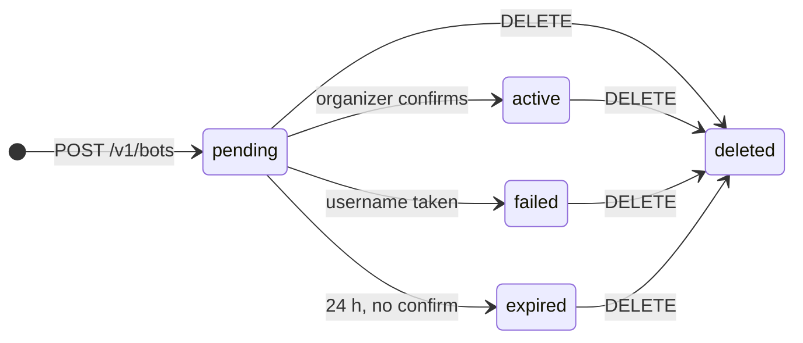

# Bot Management API: Frontend Contract

Last updated 2026-11-07. Repo snapshot of the shared doc [Bot Management API — Frontend Contract](https://claude.ai/artifact/55JGYDL6dDZEaMprvcVjiA). The machine-readable contract is [`frontend-openapi.yaml`](frontend-openapi.yaml).

## Overview

The UI talks to one API, Bot Management, at `https://h4h-narrative-stubs.onrender.com/v1`. It runs on Render's free tier as a stub: real validation, but a keyword classifier and a simulated Telegram step. It sleeps after 15 min idle, so the next request takes up to a minute, and all bots are wiped on each sleep or redeploy.

| Item | Value |
| --- | --- |
| Base URL | `https://h4h-narrative-stubs.onrender.com/v1` |
| Local base URL | `http://127.0.0.1:8000/v1` (`stubs/run.sh`) |
| Auth | None (prototype). Do not ship the URL publicly. |
| Body format | JSON, UTF-8. Send `Content-Type: application/json` on POST. |
| CORS | `Access-Control-Allow-Origin: *`, methods GET, POST, DELETE, OPTIONS |
| IDs | `bot_id` is a UUID string |
| Timestamps | ISO 8601 UTC, e.g. `2026-11-07T23:39:04Z` |
| Source of truth | `frontend-openapi.yaml` (OpenAPI 3.1, single file, generated from `bot-management-api.yaml` + `common.yaml`) |

The UI never calls the classifier or the webhook runtime. Narrative names come from `GET /v1/taxonomy` on this API.

## Creation flow and status

A bot only answers messages once it is `active`, and that needs the organizer to confirm in Telegram. The UI drives this by showing `creation_link` and polling the bot.



1. `POST /v1/bots` returns 201 with `status: "pending"`, `creation_link` and `expires_at`.
2. Show `creation_link` as the primary button, plus the time left until `expires_at`.
3. Poll `GET /v1/bots/{bot_id}` every few seconds (3 s suggested) while `pending`. Stop once the status changes.
4. Branch on the new status:
   - `active`: show `telegram_link` (`https://t.me/<username>`).
   - `failed`: show `failure_reason`. To retry, create a new bot with a different username.
   - `expired`: offer to create the bot again.

`failed`, `expired` and `deleted` are final. A bot never returns to `pending`.

## Endpoints

Five endpoints cover the whole UI: load the taxonomy, create a bot, poll it, list bots, delete one.

| Method | Path | Purpose | Success | Errors |
| --- | --- | --- | --- | --- |
| GET | `/v1/taxonomy` | Narrative and sub-narrative names for the mapping pickers | 200 `Taxonomy` | 503 |
| POST | `/v1/bots` | Create a bot; starts the Telegram confirmation step | 201 `Bot` | 400, 422, 503 |
| GET | `/v1/bots` | List bots, newest first, paged | 200 `{bots, next_cursor}` | 400 |
| GET | `/v1/bots/{bot_id}` | One bot's status and config; poll after create | 200 `Bot` | 404 |
| DELETE | `/v1/bots/{bot_id}` | Deactivate a bot (soft delete) | 204, no body | 404 |

### GET /v1/taxonomy

Load once when the bot form opens. Use the strings verbatim as mapping keys. A narrative with an empty `subnarratives` list can only be mapped at narrative level.

```json
{
  "taxonomy_version": "semeval2025-t10-urw",
  "narratives": [
    {
      "name": "Blaming the war on others rather than the invader",
      "subnarratives": ["Ukraine is the aggressor", "The West are the aggressors"]
    },
    {
      "name": "Hidden plots by secret schemes of powerful groups",
      "subnarratives": []
    }
  ]
}
```

The live response has 11 narratives and 38 sub-narratives.

### POST /v1/bots

Send a `BotConfig`. Optional message fields may be omitted; the response echoes the config with defaults filled in.

```json
{
  "display_name": "Odesa Fact Check",
  "username": "odesa_factcheck_bot",
  "confidence_threshold": 0.6,
  "other_response": "Мы не нашли известного нарратива.",
  "responses": [
    {
      "narrative": "Blaming the war on others rather than the invader",
      "subnarrative": "The West are the aggressors",
      "text": "Утверждения о «провокации НАТО» — частый приём."
    }
  ]
}
```

Response `201`, captured from the live API:

```json
{
  "bot_id": "fab585fd-d91c-447f-8014-eb9358cef10f",
  "status": "pending",
  "config": {
    "start_message": "Перешлите мне сообщение, и я проверю его.",
    "non_text_message": "Пожалуйста, перешлите текстовое сообщение или пост с подписью.",
    "error_message": "Сейчас не удаётся проверить сообщение. Попробуйте позже.",
    "display_name": "Odesa Fact Check",
    "username": "odesa_factcheck_bot",
    "confidence_threshold": 0.6,
    "other_response": "Мы не нашли известного нарратива.",
    "responses": [ … ]
  },
  "taxonomy_version": "semeval2025-t10-urw",
  "created_at": "2026-11-07T23:47:07Z",
  "creation_link": "https://t.me/newbot/STUB_MANAGER_bot/odesa_factcheck_bot?name=fab585fd-…",
  "expires_at": "2026-11-08T23:47:07Z"
}
```

Show `creation_link` as the main call to action. The organizer must open it in Telegram and confirm.

### GET /v1/bots

Query parameters, all optional:

| Param | Type | Default | Notes |
| --- | --- | --- | --- |
| `status` | `pending` \| `active` \| `failed` \| `expired` \| `deleted` | none | Filter |
| `limit` | integer 1–200 | 50 | Page size |
| `cursor` | string | none | Pass the previous response's `next_cursor` |

```json
{ "bots": [ /* Bot, newest first */ ], "next_cursor": "50" }
```

`next_cursor` is `null` on the last page. Treat it as opaque.

### GET /v1/bots/{bot_id}

Returns a `Bot`. Deleted bots still return 200 with `status: "deleted"`. 404 means the ID never existed.

### DELETE /v1/bots/{bot_id}

Returns 204 with no body. Calling it again also returns 204. The bot stays readable with `status: "deleted"` and `deleted_at`. Configs cannot be edited: to change replies, create a new bot and delete the old one.

## Schemas

Mirror these limits in the form so most 422s never happen. Unknown fields are rejected.

### BotConfig (request body of POST /v1/bots)

| Field | Type | Required | Limits | Default / notes |
| --- | --- | --- | --- | --- |
| `display_name` | string | yes | 1–64 chars | Telegram display name |
| `username` | string | yes | 5–32 chars, regex `^[A-Za-z][A-Za-z0-9_]{1,28}[Bb][Oo][Tt]$` | Must end in "bot". Taken names can't be checked up front; they fail later as `username_occupied`. |
| `description` | string | no | ≤ 512 | Shown in the empty chat before Start |
| `short_description` | string | no | ≤ 120 | Profile and shared links |
| `start_message` | string | no | ≤ 4096 | "Перешлите мне сообщение, и я проверю его." |
| `non_text_message` | string | no | ≤ 4096 | "Пожалуйста, перешлите текстовое сообщение или пост с подписью." |
| `error_message` | string | no | ≤ 4096 | "Сейчас не удаётся проверить сообщение. Попробуйте позже." |
| `confidence_threshold` | number | yes | 0–1 | Labels scoring below it are ignored. 0.6 is a sensible default for the slider. |
| `responses` | `ResponseMapping[]` | yes | may be empty | Each (narrative, subnarrative) pair at most once |
| `other_response` | string | yes | 1–4096 | Sent when nothing passes the threshold or nothing is mapped |

### ResponseMapping

| Field | Type | Required | Rules |
| --- | --- | --- | --- |
| `narrative` | string | yes | Exactly a `narratives[].name` from the taxonomy |
| `subnarrative` | string or `null` | yes, send `null` explicitly | `null` = narrative-level reply. Otherwise exactly one of that narrative's `subnarratives`. |
| `text` | string | yes | 1–4096 chars |

A narrative-level reply covers all its sub-narratives unless a sub-narrative has its own mapping. Suggested UI: one reply box per narrative, with an expandable override per sub-narrative.

### Bot (response)

| Field | Type | Present when |
| --- | --- | --- |
| `bot_id` | UUID string | always |
| `status` | `pending` \| `active` \| `failed` \| `expired` \| `deleted` | always |
| `config` | `BotConfig`, defaults filled in | always |
| `taxonomy_version` | string | always |
| `created_at` | ISO 8601 | always |
| `creation_link` | URL | `pending` |
| `expires_at` | ISO 8601 | `pending` (24 h after creation) |
| `telegram_link` | URL, `https://t.me/<username>` | `active` |
| `failure_reason` | string, e.g. `username_occupied`, `bot_limit_exceeded` | `failed` |
| `deleted_at` | ISO 8601 | `deleted` |

Fields not listed for the current status are omitted, not `null`.

### Taxonomy

| Field | Type |
| --- | --- |
| `taxonomy_version` | string |
| `narratives[].name` | string |
| `narratives[].subnarratives` | `string[]`, may be empty |

## Errors

Every error body has the same shape. On a 422, show each `details` item next to the form field its `field` path points to.

```json
{
  "error": "validation_failed",
  "message": "4 problem(s) in config",
  "details": [
    { "field": "username", "issue": "pattern_mismatch" },
    { "field": "confidence_threshold", "issue": "out_of_range" },
    { "field": "responses[0].narrative", "issue": "unknown_narrative" },
    { "field": "responses[1].subnarrative", "issue": "unknown_subnarrative" }
  ]
}
```

| HTTP | `error` | When | UI action |
| --- | --- | --- | --- |
| 400 | `invalid_request` | Body is not JSON, or a bad query param on `GET /v1/bots` | Bug on our side; log it |
| 404 | `not_found` | Bot ID never existed, or unknown path | "Bot not found" |
| 422 | `validation_failed` | Config breaks a rule; see `details` | Inline field errors |
| 503 | `model_unavailable` | Classifier down, so the taxonomy can't load or the config can't be checked | Retry banner |
| 500 | `internal` | Unexpected server error | Generic error + retry |

### Validation issue codes

| `issue` | Meaning |
| --- | --- |
| `required` | Required field missing |
| `wrong_type` | Wrong JSON type, e.g. threshold sent as a string |
| `out_of_range` | Length or number outside its limits |
| `pattern_mismatch` | `username` fails the Telegram pattern |
| `unknown_field` | Field not in the schema |
| `unknown_narrative` | Narrative not in the taxonomy (check for stray spaces) |
| `unknown_subnarrative` | Sub-narrative not listed under that narrative |
| `duplicate_mapping` | Same (narrative, subnarrative) pair appears twice |

`field` uses dot and index paths: `username`, `responses[2].text`, `responses[3]` (whole item, for duplicates).

## Stub-only notes

The hosted API is a stub. These differences go away with the real backend; nothing else in this contract changes.

- **Activating a bot:** `creation_link` is a placeholder and opening it does nothing. To move a bot from `pending` to `active` while building the UI, call the dev-only endpoint below. It needs an `X-Dev-Key` header; ask Hailey for the key. Never call it from shipped UI code.

```bash
curl -X POST https://h4h-narrative-stubs.onrender.com/v1/_dev/bots/$BOT_ID/activate \
  -H "X-Dev-Key: $DEV_KEY" -H 'Content-Type: application/json' -d '{}'
```

- **Testing the failed state:** send body `{"fail": "username_occupied"}` to the same endpoint.
- **Testing the expired state:** pending bots expire 24 h after creation. There is no shortcut.
- **Testing a 503:** none from the UI side; the classifier is in the same process and stays up.
- **Unsupported methods:** `PUT` and `PATCH` return 501 with an HTML body, not the JSON error shape. The API has no update endpoint by design.
- **Shared data:** everyone using the hosted URL sees the same bots, and they are wiped whenever the service sleeps or redeploys. Use clearly fake usernames such as `test_<name>_bot`.
- **OpenAPI file:** `frontend-openapi.yaml` in the repo, a single file for typed clients and mocks (e.g. openapi-typescript).
